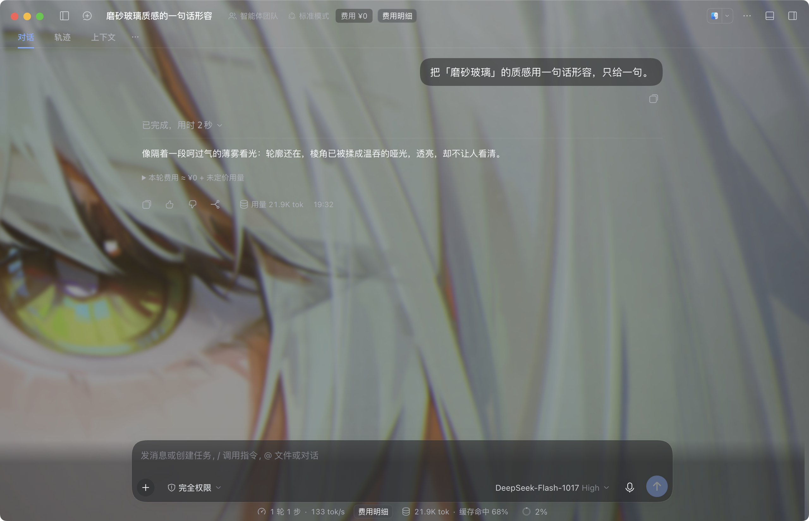
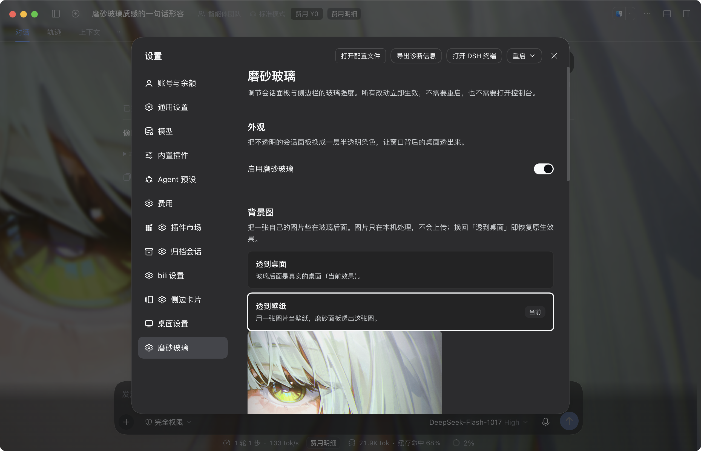

# dsh-vibrancy-skin

**给 DSH NEXT / DSH Desktop 换一层 macOS 原生磨砂玻璃。只改背景材质，不动布局。**

## 这是什么

DSH 的窗口本身已经开了 macOS 原生 Vibrancy（`NSVisualEffectView`），但上游 CSS 在会话面板、
侧边栏、气泡、输入框上盖了一层不透明底色，玻璃就被挡住了。这个插件只做一件事：**把这些实心底色
换成同族的半透明**，让窗口里原本就有的毛玻璃透出来。

它不重建 UI、不改任何第三方插件的文件、不碰布局（尺寸 / 间距 / 圆角 / 网格一律不动），
也不发任何网络请求。全部效果都是纯 CSS 注入，关掉总开关即像素级回到原生。

## 效果一览

- **会话面板 / 底栏**：主区域整片磨砂；输入框、消息气泡、文件卡片、cost 侧栏面板半透明
- **第三方侧边栏**（如 dsh-better-sidebar）：面板、标签栏、底部工作台同款磨砂；可选「深层玻璃」把内部卡片 / 列表也玻璃化
- **三层强度**：磨砂 24% / 均衡 40%（默认）/ 实心 62%
- **背景图**：「透到壁纸」把一张自己的图片垫在玻璃后面，或「透到桌面」直接透真实桌面；壁纸模式可调磨砂度
- **设置页**：所有控件即时生效，不用重启、不用开控制台
- **弹层保持不透明**：对话框、命令面板仍然实心，保证可读性

## 环境要求

- **macOS**（Windows / Linux 没有这套窗口材质，装了也不会有任何变化）
- **DSH NEXT 2.0.x** 或 **官方 DeepSeek Harness 客户端 0.2.x**（两者共用 `~/.dsh/profiles/desktop`，装一次两边都生效）
- 窗口材质为透明（NEXT 默认即是；官方客户端同样符合）

## 安装

### 从插件市场（推荐）

收录后，打开 DSH → 设置 → 插件市场，搜索「磨砂玻璃」或 `dsh-vibrancy-skin` 安装，然后重启 DSH。

> 市场收录还在准备中。收录前可以先按下面的方式手动安装。

### 手动安装（npm 包 / 源码）

包已发布到 npm：`dsh-vibrancy-skin@1.6.1`。

完整步骤（放进 profile、加进 bundle 列表、备份与回滚）见
[docs/DEVELOPMENT.md 的「安装」一节](docs/DEVELOPMENT.md)。

## 使用

装好后打开 **设置 → 磨砂玻璃**（在设置导航里紧挨着「桌面」页）：

| 控件 | 默认 | 说明 |
| --- | --- | --- |
| 启用磨砂玻璃 | 开 | 总开关。关掉 = 摘除全部样式表，像素级回到原生 |
| 背景图 | 透到桌面 | 「透到壁纸」可挑一张本地图片垫在玻璃后；图片只在本机压缩后存进 IndexedDB，不会上传 |
| 侧边栏面板磨砂 | 开 | better-sidebar 的面板 / 标签栏 / 工作台跟着一起磨砂 |
| 深层玻璃（卡片 / 列表） | 关 | 连侧边栏内部的卡片、列表、内联编辑器也玻璃化；对比度会下降，按需开 |
| 强度 | 均衡 | 磨砂 24% / 均衡 40% / 实心 62%，三级共用同一套色板 |
| 磨砂度 | 36 | 只调壁纸自身的模糊半径：0 最清晰、100 接近纯雾面；「透到桌面」时置灰 |
| 微调 | — | 0–100 精确指定强度，预设不够用时用 |

偏好存在本机 localStorage，下次启动自动恢复；所有改动立即生效，不需要重启。

## 常见问题

**装完没反应？**

1. 确认是 macOS（其它平台整个插件是空操作）；
2. 打开 设置 → 磨砂玻璃，确认总开关是开的；
3. 重启一次 DSH（`Cmd+Q` 再打开），让新插件进入 loader。

**设置里找不到「磨砂玻璃」？**

说明插件没被挂载。市场安装后需要重启；手动安装请确认 profile 的 `dependencies` 和
`dsh.profile.bundles` 两处都有 `dsh-vibrancy-skin`。

**对话框还是实心的，是没生效吗？**

是有意为之：弹层（dialog / 命令面板）保持不透明，避免文字压在花哨背景上读不清。

**换壁纸 / 重装 DSH 后壁纸没了？**

壁纸存在浏览器 IndexedDB（按 profile 隔离），换 profile 或清数据后需要重新选图。
插件不会把图片上传到任何地方。

**会不会影响性能或布局？**

不会。只有 CSS 注入，没有轮询、没有监听循环；选择器只改 `background` 与自定义属性；
背景图是 `pointer-events: none` 的装饰层，不参与布局。

**怎么更新 / 卸载？**

- 更新：市场里点更新，或重新安装新版本；
- 临时关掉：设置里的总开关（即时、无残留）；
- 彻底卸载：市场卸载，或按开发文档 §4 手动移除。

## 兼容性

- NEXT 2.0.20-next 起（实测 2.0.22-next）；官方客户端 0.2.2-rc.1 起
- 与 dsh-better-sidebar 等第三方插件共存，不修改它们的任何文件
- 不声明 `peerDependencies`，避免内核升级时兼容性校验把整个插件拒载（原因见开发文档 §6）

## 开发

贡献或排查请看 [docs/DEVELOPMENT.md](docs/DEVELOPMENT.md)：设计不变量与逐条实证、手动安装 / 回滚、
验收清单（`node smoke-test.mjs`、`bash verify.sh`）、插件兼容性校验的源码取证。

## 许可证

[MIT](LICENSE) © Natasha123-bit